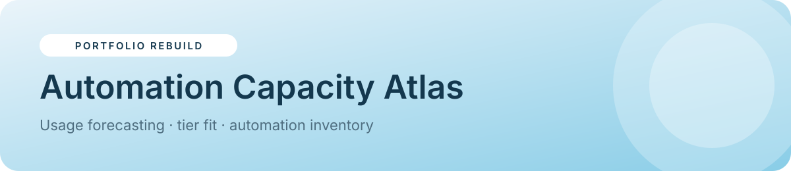

<p align="center"></p>

<p align="center">


<a href="https://sider.ai/agents/web-creator/share/695ea81100a621619985fdfb"></a>
</p>

<p align="center"><a href="https://naekitakadoportfolio.github.io/automation-capacity-atlas/"></a></p>

# Automation Capacity Atlas

A multi-page planning app for metered automation platforms. It forecasts monthly usage, finds the cheapest plan tier that fits, inventories every automation rule by consumption, and models how much you save by porting the heaviest rules to unmetered webhooks.

> **Portfolio rebuild.** A from-scratch recreation of a production system I designed and run. It uses **fictional data**, with no client names, code or branding.

## ✨ Features
- **Overview:** month-to-date actions, projected month-end, ceiling used, current add-on cost and a live recommendation
- **Daily history:** SVG bar chart per day with a month picker, peak day and daily average (three months of history)
- **Plan & tiers simulator:** pick the current tier and negotiated discount, and see which tiers fit the projection
- **Rule inventory:** 25 rules with search, space/type filters, sorting by consumption, runs or ID, and a detail modal (pause/resume, mark for migration)
- **Migration planner:** select rules or auto-pick the top port candidates, then see actions removed, new projection, the tier that now fits and annual savings
- **Spaces breakdown:** consumption and external-call counts per space
- **Month-end snapshots:** record the official counter before it resets on the 1st, with month-over-month change and validation
- **Activity log**, persisted state, light/dark theme

## 🧭 Try it
1. Open the **[live demo](https://naekitakadoportfolio.github.io/automation-capacity-atlas/)**. The Overview says no cheaper tier fits.
2. Go to *Migration planner* → **Auto-select top candidates** and watch the projection drop
3. Open *Plan & tiers* to see the cheaper tier now fits

## 🏗 Production architecture
| Layer | Production | This demo |
|---|---|---|
| Usage capture | Platform webhooks + a Chrome extension reading the activity log (no usage API exists) | Seeded history |
| Storage | Google Sheets (ACTIVITY, INVENTORY, SNAPSHOTS) | `localStorage` |
| Inventory | Parsed automation atlas joined to run counts | Seeded rules |
| UI | Apps Script HTML Service web app with a lazy-loaded atlas endpoint | Static SPA |

## 📁 Project structure
```
automation-capacity-atlas/
├── index.html        # built app (shell + app code, single file)
├── src/
│   ├── app.js        # views, state seed, business logic
│   └── app.json      # title, navigation, theme, storage key
├── assets/banner.svg # README banner
├── README.md
└── LICENSE
```

## 🚀 Run locally
No build step is needed to run it. Open `index.html`, or serve the folder:
```bash
python3 -m http.server 8000   # then visit http://localhost:8000
```
`index.html` is generated from `src/` by a small shared shell (hash router, persisted state, modals, toasts, light/dark theme).

## 🧩 Implementation notes
- `projection()` = month-to-date ÷ days elapsed × 30
- `fitTier(v)` returns the first tier whose base + add-on ceiling covers `v`
- Migration savings = Σ(runs × actions per run) of selected rules ÷ total consumption, applied to the projection

## 🗺 Roadmap
- CSV import of the platform's activity export
- Alert when the projection crosses 90% of the ceiling
- Per-rule cost attribution by team

---
<p align="center"><sub>Built by <b>Nae Kitakado</b>, AI Automation Consultant · <a href="https://www.linkedin.com/in/nae-k-203194265">LinkedIn</a> · <a href="https://sider.ai/agents/web-creator/share/695ea81100a621619985fdfb">Portfolio</a> · open to retainer &amp; part-time consulting</sub></p>
